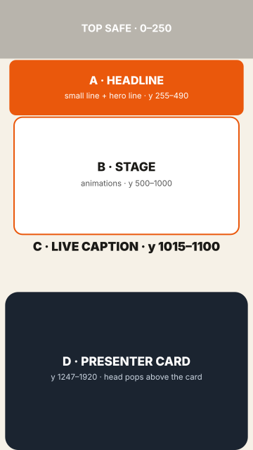

# Motion Kit (viral video editor)

A 100% code video editor for talking-head Reels (Remotion/React). Every vertical video uses the same house style, the **STACK** layout; only colours change per video.



| Zone | y (1080×1920) | What |
|---|---|---|
| Top safe | 0–250 | nothing important |
| A · headline | 255–490 | small bold line + hero line (serif italic, orange box / underline) |
| B · stage | 500–1000 | the animation area, changes every 1.5–4 s |
| C · live caption | 1015–1100 | word-by-word, max 3 words (can be small, or off) |
| D · presenter card | 1247–1920 | you, cut out, head popping above the card |
| Solo | full frame | you alone for the important statements |

**Proof rule:** every video must show the real result (page, product in use, delivered output). `makeStack().finish()` refuses a video where that is under 15% of the duration.

## Animation catalogue (zone B)
`winShot` (screenshot in an animated window, glowing line, scroll, focus + ring) · `stat` (count-up) · `plug` (app A plugs into app B) · `rivals` (scan generic competitor cards) ·
`brandKit` · `toolGrid` · `fork` (split / merge) · `promptBox` (typed prompt/comment) · `terminal` · `answer` (a real reply, typed) · plus the families in `kit/fx2/` (cards3d, data, motionfx, transitions, reels, type, ui, around, formats), plus `demo` (recorded flows) in `kit/fx/`. Catalog: `kit/fx2/CATALOG.md`.

## Themes
`setStackTheme('cream' | 'white' | 'night' | 'mint' | 'sky' | { ink, navy, orange, bg, panel, dot, serif })`: colours only, zones and scene types never change.

## Workflow
Rank the keywords first (hero / stage object / live-caption word / solo), pick a different animation type per keyword than the last video, then write the beats with times taken from the transcript (`a('phrase', n)`).
Full guide: [STACK-WORKFLOW.md](STACK-WORKFLOW.md). Scaffold: `daily/video-template.ts`. Examples: [examples/](examples/).

## Layout of the repo
- `kit/` the editor: layouts, captions, STACK elements (`kit/fx/stack.tsx`, `kit/fx/kwfx.tsx`), helpers (`kit/stack.ts`, `kit/stackplan.ts`)
- `daily/` the pipeline scripts: `new_day.py` (project setup, transcription, scaffold), `render.py`, `heygen_day.py` (optional AI lip-sync from your cloned voice), `broll.py` (stock b-roll), `make_cutout.sh` + `matte.swift` (presenter cut-out), `cut_clip.sh`, `make_music.py`, `studio.py` (per-project settings), templates
- `brand-packs/` re-skin the kit per brand (see `brand-packs/README.md`) · `capture/` Playwright flow recorder for real screen proof · `examples/` two real Reels as reading guides
- `sync-kit.sh` copies the kit into a video project · `apply_brand.py` applies a brand pack

## Requirements
- **macOS on Apple Silicon** for the presenter cut-out (Apple Vision, built by `swiftc` on first use). Everything else is plain Node/Python/ffmpeg, but the scripts are only tested on macOS and use the Keychain for API keys.
- **[OpenMontage](https://github.com/calesthio/OpenMontage)** (AGPL-3.0, separate project): rendering (`video_compose`) and transcription (`transcriber`) run through it. Check it out so that this folder is `OpenMontage/projects/motion-kit`, and follow its own install instructions (Python venv, Node, Remotion).
- `ffmpeg` / `ffprobe` on your PATH.
- Optional: a [HeyGen](https://heygen.com) API key (AI lip-sync videos), a Pexels or Pixabay key (stock b-roll), Playwright (real screen captures).

API keys are read from environment variables or the macOS Keychain (service names `HEYGEN_API_KEY`, `PEXELS_API_KEY`, `PIXABAY_API_KEY`), never from files in this repo.

## Audio
Sound effects and music are not included. Put your own files in `public/sfx/` (names used by `kit/Stage.tsx`: `pop-1..4`, `whoosh-soft`, `ui-click`, `ui-ping`, `dm`, `hook-hit`, ...) and `public/music/`. `daily/make_music.py` can synthesize original background tracks. Beats can attach sounds, for example `[{ name: 'whoosh-soft', at: a('phrase') - 0.1 }]` (see `daily/video-template.ts`).

## Quick start
```bash
# from the OpenMontage/ checkout
.venv/bin/python projects/motion-kit/daily/new_day.py 01 /path/to/take.mp4 en      # project + transcript + video.ts scaffold
# edit projects/<prefix>-dia01/video.ts (keyword hierarchy, scenes, beats)
.venv/bin/python projects/motion-kit/daily/render.py projects/<prefix>-dia01 <Prefix>Dia01 reel.mp4 0.25   # quick check at 25% scale
```
`<prefix>` comes from `video/studio.json` (`python3 projects/motion-kit/daily/studio.py init <project-dir>` writes a draft) or defaults to the folder name. "dia" means "day": projects are numbered per video.

## AI lip-sync (optional, paid)
`daily/heygen_day.py` speaks a script in your cloned HeyGen voice and lip-syncs it onto one of your base videos (`video/takes/`). It refuses to run unless `caps_usd.heygen` in `video/studio.json` is above 0, tracks spend per month in `video/spend-heygen.csv`, and supports `--dry-run` to print the cost estimate first. At the time of writing HeyGen charged roughly US$ 0.0335 per second of speech (TTS + lip-sync); check their pricing.

## Status
Early release. The editor and animation catalogue are used in production by the author; the pipeline scripts are macOS-first and not yet packaged as an installable tool. Issues and PRs are welcome (see [CONTRIBUTING.md](CONTRIBUTING.md)).

## License
[MIT](LICENSE). See [THIRD-PARTY.md](THIRD-PARTY.md) for provenance and licence notes of bundled fonts and the code rewrite.
